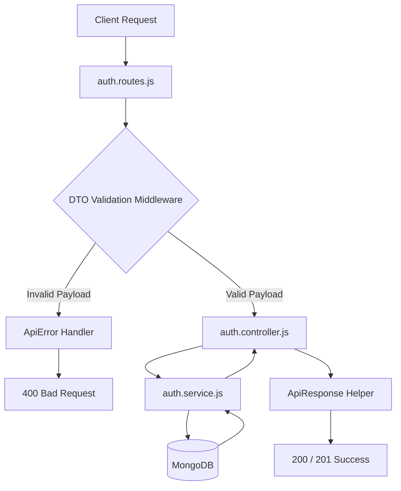

# Backend Architecture Learning Project (Node.js + Express 5)

This is a learning project designed for students and developers who want to understand how production-grade backends are structured.

In beginner Express tutorials, it is common to put validation, database queries, and response logic directly inside a single controller. In professional applications and frameworks like **NestJS** or **Spring Boot**, code is organized into clear, dedicated layers. This project demonstrates how to implement that same clean architecture in plain **JavaScript** using **Node.js** and **Express 5**.

---

## What We Built & Tech Stack

This project is a modular authentication and backend foundation built with:

- **Runtime:** Node.js (ES Modules)
- **Framework:** Express 5
- **Validation:** Joi + Custom DTO (Data Transfer Object) layer
- **Database:** MongoDB with Mongoose
- **Security & Auth:** Bcryptjs (password hashing), JSON Web Tokens (session auth), and native Node.js Crypto (verification tokens)

---

## Architecture & Request Flow

Here is how a request travels through the application from the client to the database and back:



---

## How It Works (Core Concepts)

### 1. Feature-First (Modular) Structure
Instead of putting all controllers in one folder and all models in another, the project is divided by feature domain (`modules/auth/`, `modules/cart/`). Everything related to "Authentication" stays inside the `auth` module. Reusable helpers, base classes, and database configurations live in the `common/` folder.

### 2. DTO (Data Transfer Object) Pattern
A DTO acts as a contract for incoming data:
- It defines what fields are expected (e.g., name, email, password) using Joi schemas.
- It removes any extra, unexpected fields sent by the client (`stripUnknown: true`) to keep the data clean.
- All DTOs inherit from a common `BaseDTO` class so validation logic is never duplicated.

### 3. Intercepting Validation Middleware
Instead of validating data inside the controller:
- The middleware runs the DTO check **before** the controller is called.
- If the payload is invalid, the request stops immediately and returns a clean error list.
- The controller only ever receives clean, verified data in `req.body`.

### 4. Controller vs. Service Layer
- **Controller:** Only deals with HTTP responsibilities (reading request data, passing it to the service, and sending back the HTTP status code).
- **Service:** Contains the actual business logic (checking if an email already exists, hashing passwords, generating tokens, and saving to the database). It doesn't know anything about Express `req` or `res`.

### 5. Standard Responses & Error Handling
- **`ApiResponse`:** Ensures every successful response has a predictable structure: `{ success: true, message, data }`.
- **`apiError`:** Custom error class that standardizes error status codes and messages across the entire app.

---

## Project Structure

```text
├── server.js                    # Entry point: connects DB & starts server
├── env.example                  # Template for environment variables
├── package.json                 # Dependencies and scripts
└── src/
    ├── app.js                   # Express app setup and middleware
    ├── common/                  # Shared utilities across all modules
    │   ├── config/              # Database connection (db.js)
    │   ├── dto/                 # BaseDTO class
    │   ├── middleware/          # Validation middleware
    │   └── utils/               # ApiResponse, apiError, JWT & Crypto helpers
    └── modules/                 # Feature-based domains
        ├── auth/                # Auth module (routes, controller, service, model, DTOs)
        └── cart/                # Example template for future modules
```

---

## Getting Started

### Prerequisites
- Node.js 18 or higher
- MongoDB running locally or a MongoDB Atlas connection string
- pnpm (or npm / yarn)

### Setup & Run

1. **Install dependencies:**
   ```bash
   pnpm install
   ```

2. **Set up environment variables:**
   ```bash
   cp env.example .env
   ```
   Add your MongoDB URI and port in `.env`.

3. **Start the development server:**
   ```bash
   pnpm dev
   ```
