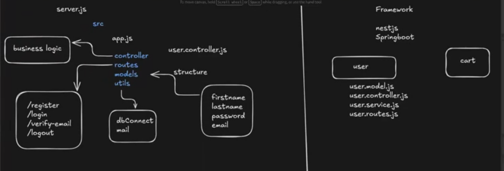

# Architecture Plan

In this project, we will learn framework structure patterns like NestJS, Spring Boot, etc.

**Note:** We can structure our code in two different ways (Layered vs Modular/Feature-based):

